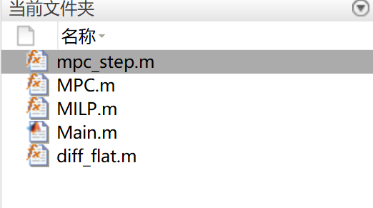
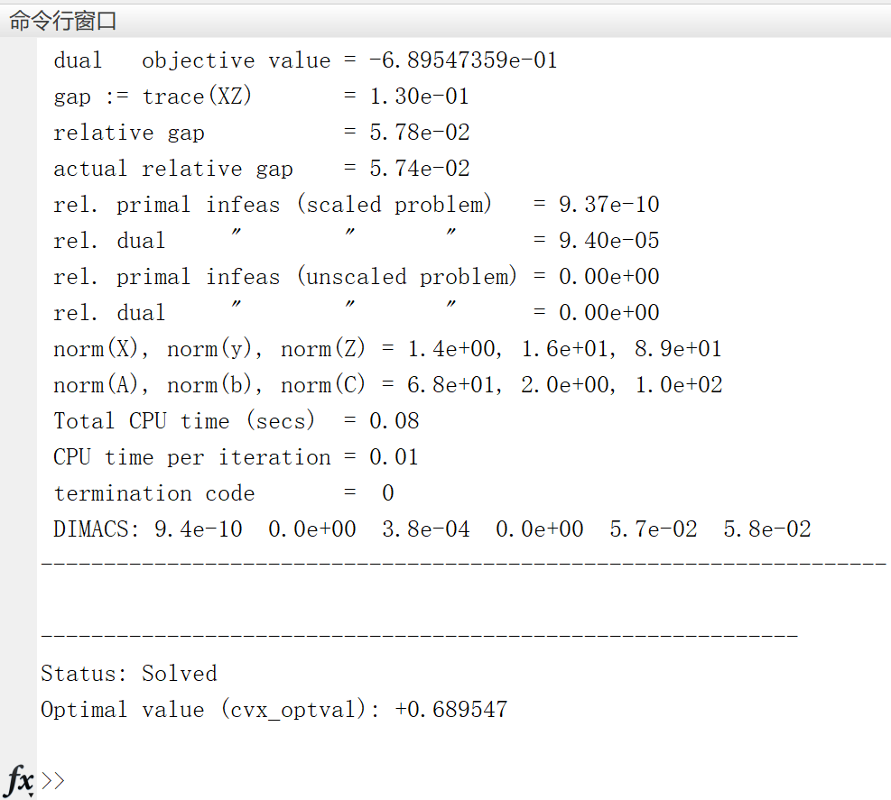
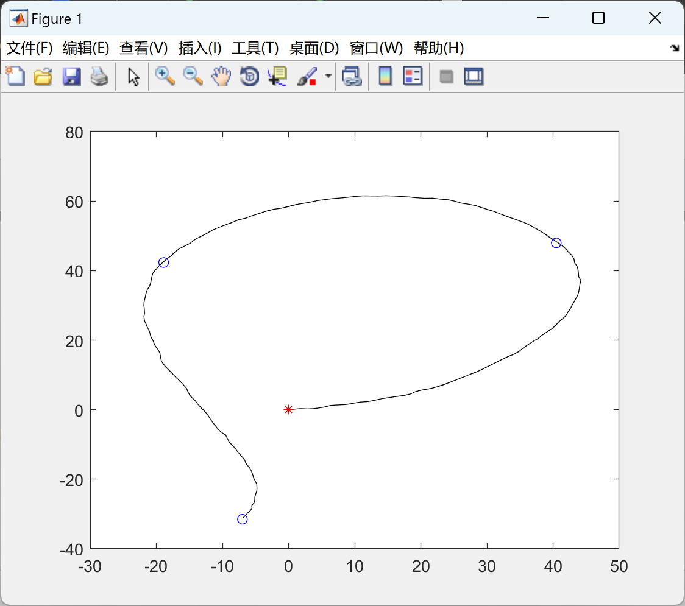

# [Based on MPC Vehicle Control]The optimal control strategy for the shortest time trajectory of fixed-wing vehicles, considering route point constraints (Matlab code implementation)

[Based on MPC for Best Control of FPV]The optimal control strategy for the shortest time trajectory of fixed-wing aircraft considering route point constraints (Matlab code implementation)
The optimal control strategy for the shortest time trajectory of a fixed-wing aircraft can be achieved using Model Predictive Control (MPC). MPC is an advanced control strategy that optimizes the system dynamic model within each control cycle to calculate the optimal control input, thereby achieving the best performance of the system.
In the context of considering route points constraints, route points can be treated as constraints for system states. At the same time, other constraints (such as aircraft dynamics, performance limitations, etc.) should also be taken into account. In this way, the MPC controller can ensure that route points are reached while meeting other constraints, thus achieving the shortest possible flight trajectory for the aircraft.
In the specific implementation, a dynamic model of fixed-wing aircraft needs to be established and used as the foundation for the MPC controller. Within each control cycle, the MPC controller will predict the state of the aircraft over a certain period in the future and calculate the optimal control input through an optimization algorithm to achieve the goal of shortest time trajectory.
Additionally, the consideration of waypoint constraints can be achieved by incorporating information such as arrival times and order of waypoints into the MPC controller. This allows for the implementation of waypoint constraints. Consequently, the MPC controller can maximize flight time while ensuring that the aircraft follows the designated route.
In summary, the optimal control strategy based on MPC can be well applied to the shortest time trajectory planning of fixed-wing aircraft and can fully consider route point constraints to achieve the best performance of the aircraft.
\n        \n      \n        \n      \n        \n  

## Images

<!-- PAYMENT_BLOCK -->

## Get this dataset

- Payment link (Stripe): [Buy now](https://buy.stripe.com/3cs8yP7sY87d0vu9AB)
- Payment QR code: 

<!-- /PAYMENT_BLOCK -->
